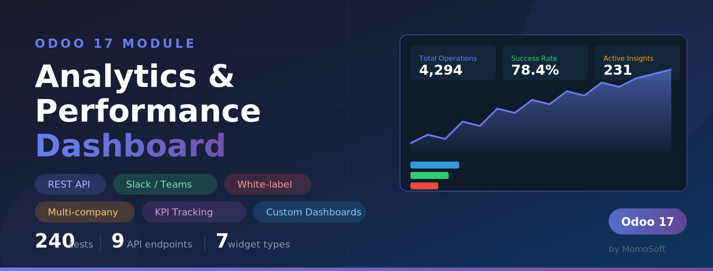
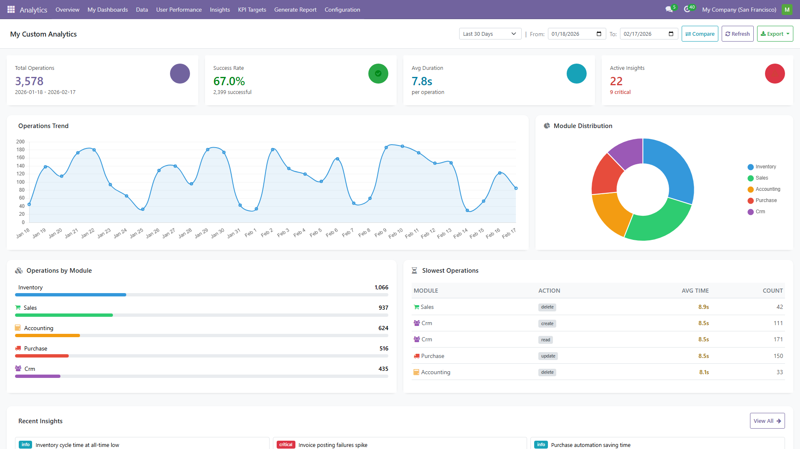
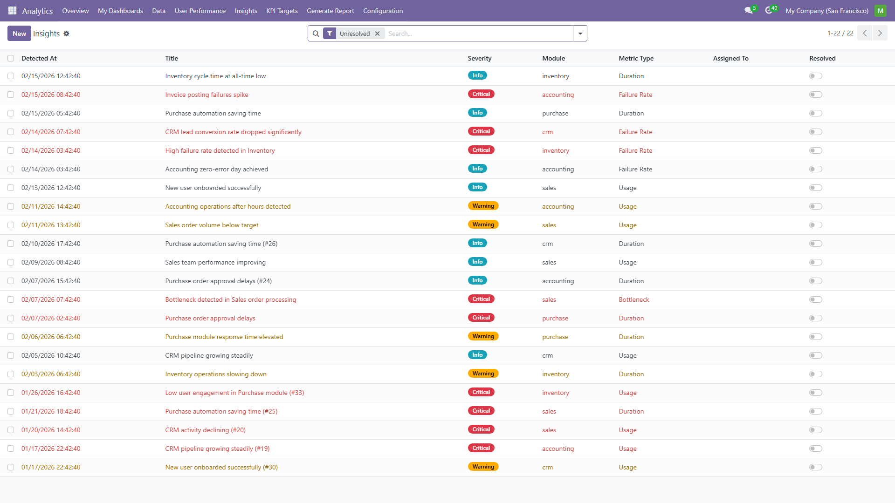
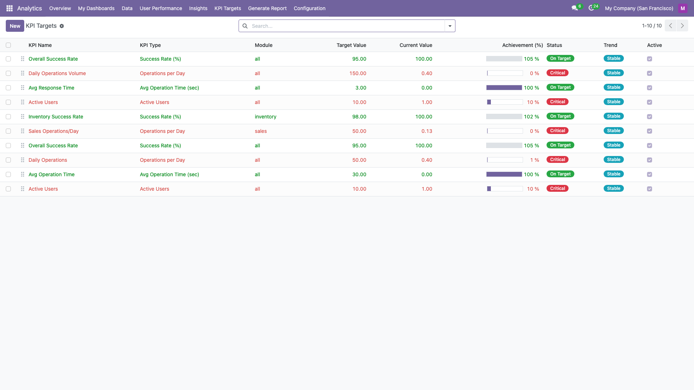
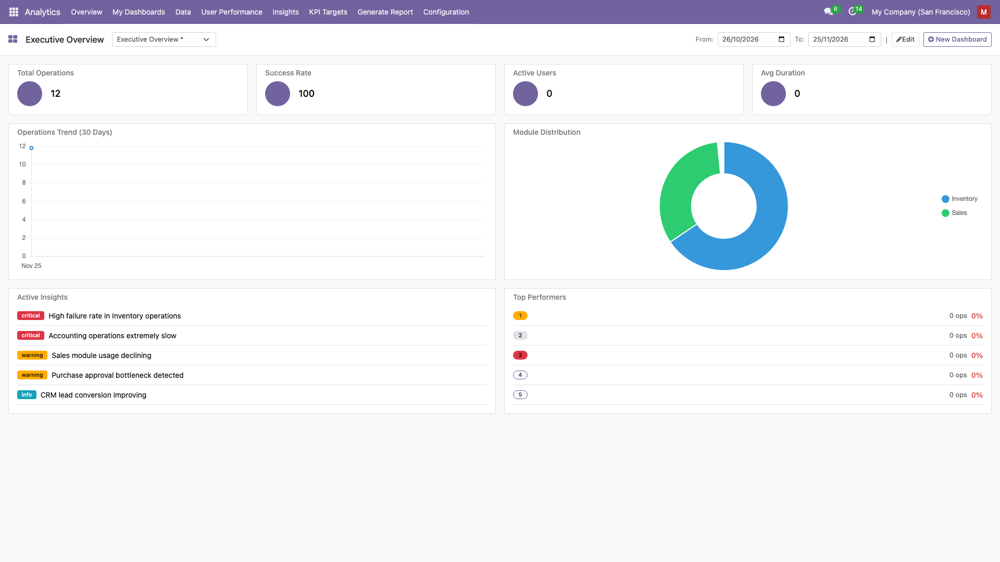
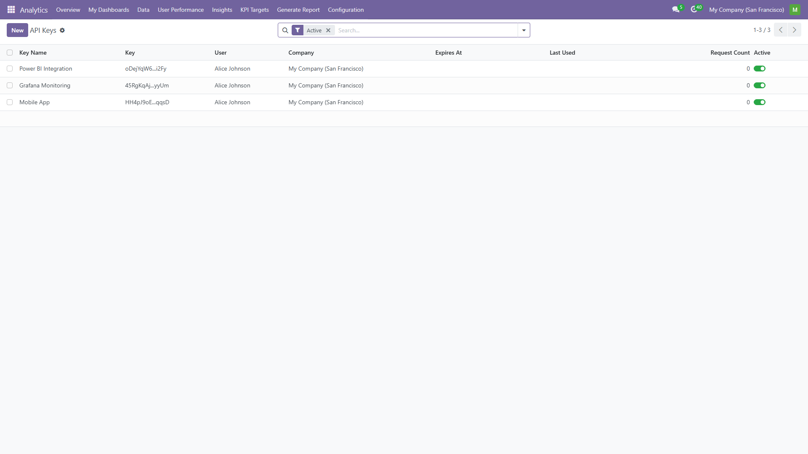
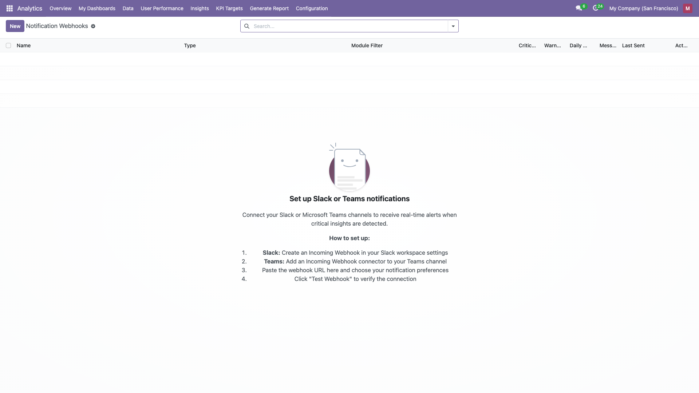
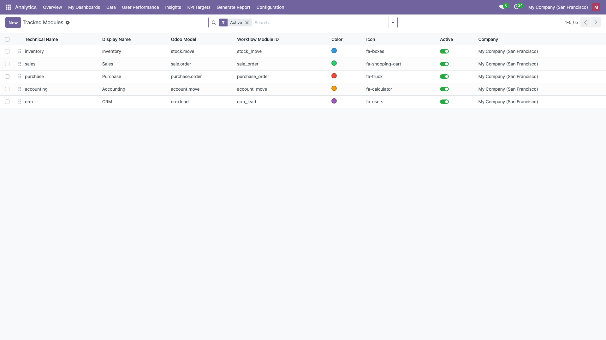

# Analytics & Performance Dashboard for Odoo 17



**Real-time analytics, intelligent insights, and custom dashboards for your Odoo ERP.**

[](https://www.odoo.com)
[](LICENSE)
[](#testing)
[](#changelog)

---

## Overview

Analytics & Performance Dashboard transforms your Odoo into a data-driven powerhouse. Track module usage, monitor workflow performance, detect anomalies automatically, and share insights via Slack, Teams, or REST API.

### Key Features

| Feature | Description |
|---------|-------------|
| **Real-time Dashboard** | KPI cards, trend charts, module distribution, slowest operations |
| **Custom Dashboard Builder** | 7 widget types, drag-and-drop, per-user dashboards |
| **Intelligent Insights** | Auto-detect anomalies, bottlenecks, and trends |
| **REST API** | 9 endpoints for Power BI, Grafana, Tableau integration |
| **Slack & Teams** | Critical alerts and daily digest notifications |
| **KPI Targets** | Set goals, track achievement %, visual status indicators |
| **User Performance** | Efficiency scoring, leaderboard, training recommendations |
| **White-label Branding** | Custom title, logo, colors per company |
| **Multi-Company** | Full data isolation, per-company configuration |
| **Configurable Modules** | Track Inventory, Sales, Purchase, Accounting, CRM + custom |

---

## Screenshots

### Main Dashboard


### Insights Engine


### KPI Targets


### Custom Dashboard Builder


### REST API Keys


### Webhook Notifications


### Tracked Modules Configuration


> See all 12 screenshots in the [screenshots/](screenshots/) folder.

---

## Quick Start

### Requirements

- Odoo 17.0 (Community or Enterprise)
- Python 3.10+
- PostgreSQL 14+

### Installation

1. Download the module from the [Odoo App Store](https://apps.odoo.com/apps/modules/17.0/analytics_module)
2. Extract to your Odoo addons directory
3. Restart Odoo and update the apps list
4. Install "Analytics & Performance Dashboard"

> Detailed instructions: [docs/installation.md](docs/installation.md)

### First Steps

1. Go to **Analytics > Overview** to see your dashboard
2. Navigate to **Analytics > Configuration > Tracked Modules** to configure which modules to track
3. Set up **KPI Targets** under Analytics > KPI Targets
4. (Optional) Configure **API Keys** and **Webhooks** under Configuration

> Full configuration guide: [docs/configuration.md](docs/configuration.md)

---

## Documentation

| Document | Description |
|----------|-------------|
| [Installation Guide](docs/installation.md) | System requirements, installation steps, Docker setup |
| [Configuration Guide](docs/configuration.md) | Tracked modules, branding, webhooks, multi-company |
| [API Reference](docs/api-reference.md) | 9 REST API endpoints with examples |
| [Dashboard Builder](docs/dashboard-builder.md) | Widget types, creating custom dashboards |
| [FAQ](docs/faq.md) | Common questions and troubleshooting |
| [Changelog](CHANGELOG.md) | Version history (v1.0 - v7.0) |

---

## REST API Quick Example

```bash
# Health check (no auth required)
curl http://localhost:8069/api/v1/analytics/health

# Get dashboard data
curl -H "X-API-Key: YOUR_KEY" \
  "http://localhost:8069/api/v1/analytics/dashboard?date_from=2024-01-01&date_to=2024-01-31"

# Get insights filtered by severity
curl -H "X-API-Key: YOUR_KEY" \
  "http://localhost:8069/api/v1/analytics/insights?severity=critical&limit=10"

# Export to CSV
curl -H "X-API-Key: YOUR_KEY" -o usage.csv \
  "http://localhost:8069/api/v1/analytics/export/usage"
```

> Full API documentation: [docs/api-reference.md](docs/api-reference.md)

---

## Testing

The module includes **240 unit tests** across 28 test classes:

```bash
# Run all analytics tests
./odoo-bin -d test -u analytics_module --test-enable --stop-after-init \
  --test-tags analytics
```

Test coverage includes:
- Core models (usage, workflow, insights, metrics)
- Dashboard builder and widget rendering
- REST API endpoints and pagination
- Webhook notifications (Slack/Teams formatting)
- KPI targets and user performance
- Multi-company data isolation
- Tracked module configuration
- Performance optimizations (batch SQL, indexes)

---

## Technical Highlights

- **OWL Components**: Dashboard and Dashboard Builder built with Odoo 17's OWL framework
- **Chart.js**: Interactive line charts and doughnut charts
- **Batch SQL**: Optimized queries with no N+1 loops
- **6 Composite Indexes**: Fast filtering by company + module + timestamp
- **API Pagination**: Configurable offset/limit (max 1000 records)
- **Parameterized SQL**: Safe from SQL injection

---

## Support

- **Email**: odoo@momosoft.com
- **Issues**: [GitHub Issues](https://github.com/chalermchaic/odoo-analytics/issues)
- **Odoo Store**: [Analytics & Performance Dashboard](https://apps.odoo.com/apps/modules/17.0/analytics_module)

---

## License

This module is licensed under [LGPL-3](LICENSE).

**Author**: MomoSoft | **Maintainer**: MomoSoft
