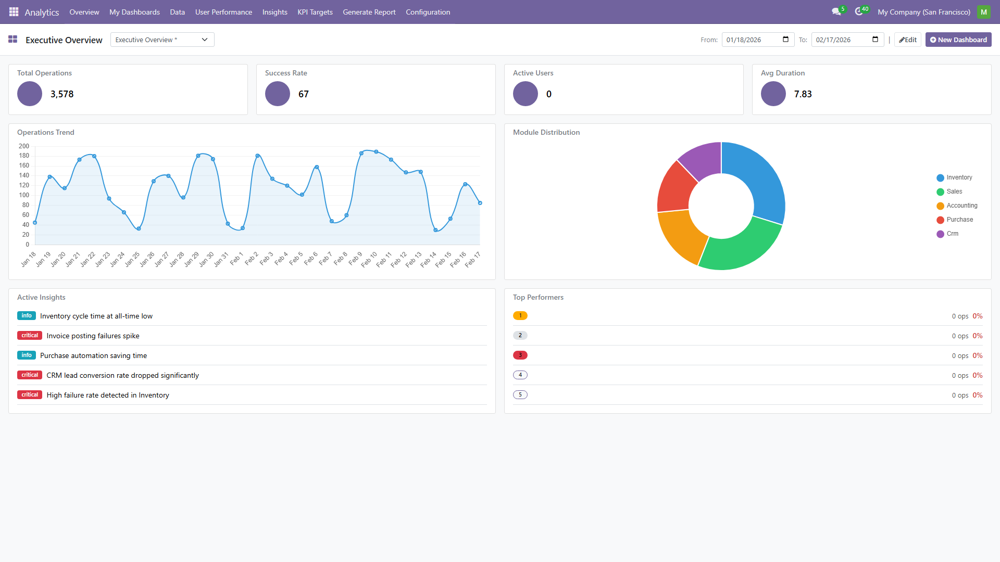
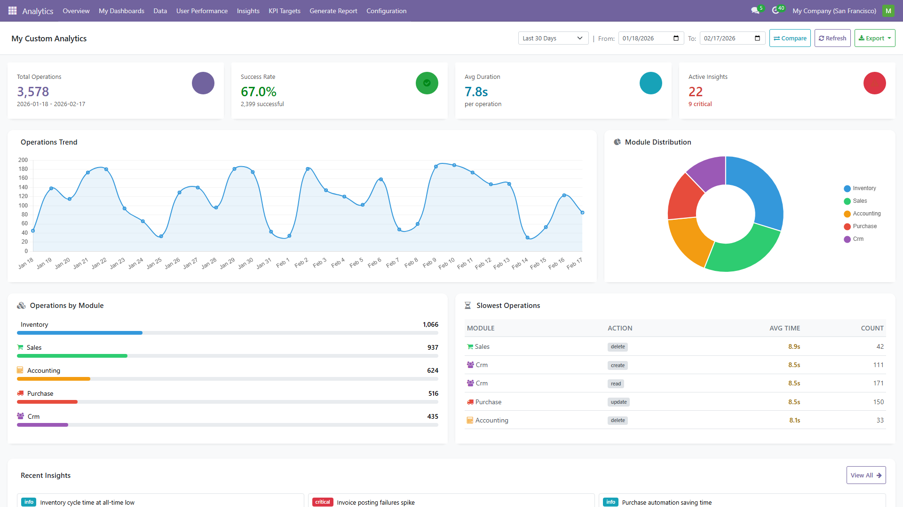

# Custom Dashboard Builder

Create personalized dashboards with drag-and-drop widgets.



---

## Getting Started

1. Navigate to **Analytics > My Dashboards**
2. Click **New Dashboard**
3. Enter a name for your dashboard
4. A default layout with 8 widgets is created automatically

---

## Widget Types

The dashboard builder offers **7 widget types**:

### KPI Card


- **Size**: Quarter width (3/12)
- **Shows**: Single metric with large number
- **Metrics available**:
  - Total Operations (count)
  - Success Rate (percentage)
  - Avg Duration (seconds)
  - Active Insights (count)

### Line Chart

- **Size**: Two-thirds width (8/12)
- **Shows**: Operations trend over time (daily)
- **Data**: Aggregated operations per day within date range
- **Library**: Chart.js with smooth curves

### Doughnut Chart

- **Size**: One-third width (4/12)
- **Shows**: Module distribution (operations per module)
- **Colors**: Automatically uses module colors from Tracked Modules config

### Operations Table

- **Size**: Full width (12/12)
- **Shows**: Recent operations list
- **Columns**: Timestamp, Module, Action, User, Status
- **Config**: `limit` (default: 10), `module` (optional filter)

### Insight List

- **Size**: Half width (6/12)
- **Shows**: Active/unresolved insights
- **Display**: Severity badge (Critical/Warning/Info) + title
- **Config**: `limit` (default: 5)

### Module Breakdown

- **Size**: Half width (6/12)
- **Shows**: Operations count per module with progress bars
- **Display**: Module icon + color + count + percentage bar

### Top Performers

- **Size**: Half width (6/12)
- **Shows**: User leaderboard
- **Display**: Rank, name, operations count, efficiency score
- **Config**: `limit` (default: 5)

---

## Default Dashboard Layout

New dashboards are created with this default layout:

```
Row 1: [KPI: Total Ops] [KPI: Success Rate] [KPI: Avg Duration] [KPI: Insights]
Row 2: [============ Line Chart ============] [Doughnut]
Row 3: [==== Module Breakdown ====] [===== Insight List =====]
```

---

## Editing Dashboards

### Enter Edit Mode

1. Open your dashboard
2. Click **Edit** button in the toolbar
3. Widgets show edit controls (borders highlight)

### Add Widget

1. Click **Add Widget** button
2. Select from the widget catalog
3. New widget is added at the bottom

### Resize Widget

Click the **resize** button on a widget to cycle through sizes:
- **3/12** - Quarter
- **4/12** - Third
- **6/12** - Half
- **8/12** - Two-thirds
- **12/12** - Full width

### Reorder Widgets

Use **Move Up** / **Move Down** buttons to change widget order.

### Remove Widget

Click the **X** button on a widget to remove it.

### Save Changes

Click **Save** to persist your changes. All widget configurations are stored per-user.

---

## Date Filtering

All widgets respond to the global date filter at the top of the dashboard:

- **Quick Presets**: Last 7 Days, Last 30 Days, Last 90 Days, This Year
- **Custom Range**: Pick specific From/To dates
- Changing dates refreshes all widgets automatically

---

## Multiple Dashboards

You can create multiple dashboards for different purposes:

- **Executive Overview**: KPIs + trend chart + insights
- **Operations Monitor**: Tables + module breakdown + slow operations
- **Sales Focus**: Filter table by Sales module + KPIs
- **Team Performance**: Top performers + user metrics

### Set Default Dashboard

Toggle the **Is Default** checkbox to make a dashboard open automatically when you navigate to My Dashboards.

---

## Performance

The dashboard uses optimized data loading:

- **Single RPC call** loads all widget data at once (no N+1 queries)
- **Batch SQL** for aggregation queries
- Charts render asynchronously after data loads
- Date range changes reload only the data, not the entire page
